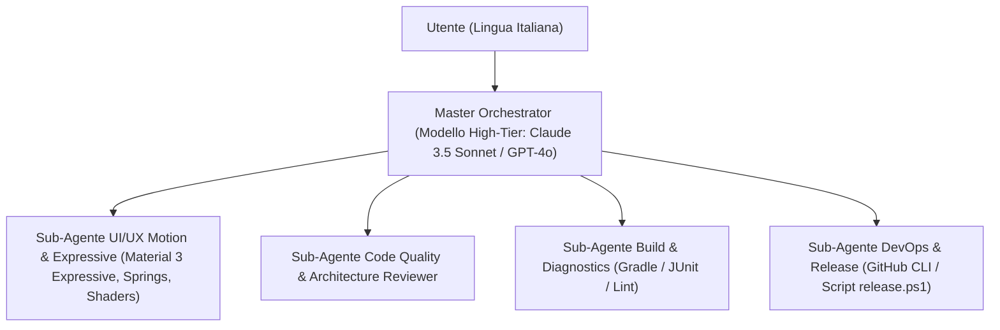

# Handover Tecnico & Guida Architetturale per CodiumAI / Qodo

**Progetto**: Calendario Turni (RFI Pro / SuperShift Evolution)

**Versione Corrente**: v1.4.1 (versionCode 22, APK compilato e testato; sul Realme resta installata v1.4.0; nessuna pubblicazione GitHub)

**Target Platform**: Android Nativo (Kotlin + Jetpack Compose)

**Parametri SDK**: compileSdk 32, minSdk 26, targetSdk 32, Java 11

**Repository Git**: `https://github.com/Hellvisback/calendario-turni.git`

**Branch Principale**: `main`

**Ambiente di Lavoro**: Locale su macchina Windows dell'utente (`c:\Users\marco\Antigravity Progetti\Calediario Turni`)


---


## Aggiornamento nativo v1.4.1 — 26 ottobre 2026

Implementate le correzioni del grafico statistico (un’unica testa di avanzamento sul contorno, proporzioni riferite alla sola parte visibile), ancoraggio Periodo senza anteprima globale, numerazione dei cicli nell’anteprima Rotazione e stelle predefinite gialle. La gomma cancella turno singolo e reperibilità atomicamente, con un solo Annulla; il selettore resta per più assegnazioni. La colorazione del calendario è guidata da una richiesta esplicita per l’ultimo giorno toccato, anche in Più turni, senza riavviare le celle precedenti.

Widget: intestazioni più compatte, giorno separato dall’etichetta, rendering alla densità nativa con limite di memoria, doppio turno prioritario rispetto agli extra. Sveglie: viste Regole/Prossime distinte, interruttore generale, disattivazione/riattivazione delle regole e strumenti di diagnostica raccolti. Queste revisioni visive richiedono ancora il confronto sul Realme.

Google Cloud configurato nel progetto `ascendant-yeti-512823-f8`, API Drive/Calendar attive e client Android per la firma esistente. Stato OAuth **Esterno / Test**, proprietario aggiunto agli utenti di test: non ancora disponibile indistintamente a tutti gli account. Consultare `docs/GOOGLE_SETUP_v1.4.1.md`. Aggiunti pulsante Google ufficiale e backup automatico privato via JobScheduler. Nessun account preimpostato, nessun successo remoto simulato.

Stato collaudo v1.4.1: `assembleDebug test` superato; 312 test debug e 312 release, zero errori/failure/skipped. Firma esistente verificata con apksigner. Dettagli in `docs/VERIFICA_v1.4.1.md`. Ultima versione verificata/installata sul telefono: v1.4.0. ADB attualmente non avviabile nel profilo Windows protetto (`Cannot mkdir \.android`); nessuna installazione v1.4.1 né prova remota Drive/Calendar dichiarata. Java 11 portatile ufficiale usato esclusivamente nel workspace perché il runtime Android Studio non è eseguibile dal profilo corrente.

---

## Aggiornamento nativo v1.4.0 — 26 ottobre 2026

I quattro widget usano `TurniWidgetRenderer`, con rendering Canvas statico fuori dal thread UI, palette chiara/scura condivisa, colori personalizzati, giorno corrente, weekend, campanella, dettagli per assegnazione e filtro del lavoro attivo. Le dimensioni minime dei nuovi posizionamenti sono adeguate alla leggibilità; i widget già presenti possono conservare dimensioni inferiori e usare una visualizzazione compatta. Navigazione avanti/indietro e ritorno al periodo corrente sono indipendenti per widget; il tap apre il giorno corretto.

Rimossi gli account Google preimpostati. `GoogleAccess` apre il selettore ufficiale degli account e il consenso `AuthorizationClient`; memorizza solo identità verificata con Google userinfo, senza salvare token. `GoogleCloudApi` usa HTTPS reale per backup privato Drive e Google Calendar. Il calendario di destinazione viene scelto esplicitamente; la pulizia elimina solo eventi posseduti da TurniSync e rispetta il lavoro selezionato. `CloudBackupScreen` distingue il backup remoto manuale, la copia locale automatica all’apertura e import/export file. Il ripristino con anteprima valida i riferimenti prima di applicare lo snapshot e azzera lo storico Annulla del calendario per evitare riferimenti orfani.

**Nota storica v1.4.0: configurazione OAuth all’epoca non fornita/verificata; vedere l’aggiornamento v1.4.1 sopra per lo stato attuale.** Collaudato sul Realme il selettore ufficiale e l’annullamento senza falso collegamento; non selezionato un account personale né concesso accesso ai dati. Trasferimento Drive/Calendar reale da collaudare dopo configurazione progetto Google Cloud e consenso dell’utente. Consultare `docs/GOOGLE_SETUP_v1.4.0.md` per package, impronta SHA-1, API e scope. Nessun successo remoto simulato.

Sveglie: `ShiftAlarmScheduler` registra una sveglia esatta `setAlarmClock`; `ShiftAlarmReceiver` avvia `ShiftAlarmService` con audio `USAGE_ALARM`, vibrazione, notifica persistente e attività a schermo bloccato `ShiftAlarmActivity`. Riproduzione limitata a 2 minuti (prova 20 secondi), arrestabile. Il servizio non altera volume o Non disturbare. La schermata controlla permessi notifiche/sveglie esatte, canale, volume e impostazioni background del produttore; aggiornamenti/reboot/cambio ora rischedulano il prossimo evento. Prova sul Realme Android 13 con schermo spento: MediaPlayer attivo sul canale sveglie e schermata Ferma corretta; arresto verificato. La riproduzione effettiva è confermata dal sistema audio, non da una valutazione uditiva remota.

Build `assembleDebug test` superata: **295 test per variante debug/release**, zero errori/failure/skipped. APK v1.4.0 firmato con la chiave debug esistente e installato con `-r`; SHA-256 locale/installato `69c1f2663ebdbb5965c1f2a8d5f3d7ca08af8c5077bf6b0881b70a0aaed04d25`. Database prima/dopo identico: 122 assegnazioni, 11 modelli, un lavoro, due rotazioni. Nessuna release GitHub e nessun accesso OneDrive.

---

## Aggiornamento nativo del 25 ottobre 2026

Revisione v1.3.4: movimento del dock reso più leggibile (rilascio 740 ms, assorbimento 660 ms, curva Material), con icone visibili prima del distacco completo. I due pulsanti laterali sono spostati di 6 unità normalizzate verso l'esterno, circa 5,4 dp per lato sul Realme. Il contorno precalcolato mantiene il collegamento liquido più a lungo e si separa completamente a riposo; rigenerato con `scripts/generate-dock-contours.py`. Asset invariato in dimensione (185700 byte) e nessun nuovo calcolo SDF a runtime. I target centrali hanno priorità nello z-order durante la sovrapposizione temporanea delle gocce. Build e 267 test per variante confermati. Nessuna modifica ai dati o alle regole dei turni.


Revisione prestazioni v1.3.2: disabilitati i Live Literals Compose anche nell'APK debug; il dock interpola il contorno originale da `res/raw/dock_contours.bin`, generato da `scripts/generate-dock-contours.py`, invece di eseguire ricerche SDF sul thread UI. Le statistiche usano una LazyColumn, aggregati memorizzati e contatori disegnati senza rimisurare il testo. Ingresso/uscita modifica sposta la geometria Canvas senza ridimensionare il layout del calendario a ogni fotogramma; lo stato di modifica è osservato nella sola destinazione/dock. I mesi laterali hanno animazione immediata e nessun duplicato dei target accessibili.


Straordinario e trasferta hanno fasce celeste/verde unite al turno, minuti esatti (`+30m`, `+1h30`) e comparsa/rimozione animate. Nelle celle senza spazio sufficiente restano indicatori compatti e il turno base rimane visibile; il dettaglio conserva tutti i dati. Aggiunti tre test di regressione, per 267 test per variante debug/release. Profilazione reale con `dumpsys gfxinfo` conservata nel workspace: sequenza a freddo statistiche/calendario/modifica/ritorno, mediana prima 400–450 ms e dopo 36–40 ms; p90 prima 850 ms e dopo 250 ms. Restano frame fuori budget e picchi di 700–750 ms al primo caricamento: questi dati documentano un miglioramento, non 60 fps garantiti. APK ancora firmato con la chiave debug esistente; nessuna release GitHub.


Revisione grafica v1.3.1: il primo porting v1.3.0 era troppo distante dal progetto approvato. `SiteIcons` riprende icone outline e animazioni articolate; `TurniDock` usa il contorno a distanza smussata del prototipo. `ReportExpressiveShapes` contiene le sagome originali; `SiteCatalogScreen` è il catalogo attivo. Pannelli, editor, palette, footer, statistiche e impostazioni sono stati riallineati al codice web. I vecchi cataloghi/editor con prefisso `Legacy` restano inattivi. Confermati 264 test per variante, verifiche sul Realme in entrambi i temi e conservazione dei dati dopo le prove annullate. Le schermate web sono il riferimento visivo; i modelli e le regole native rimangono la fonte dei dati reali.


Il prototipo TurniSync è stato portato nelle schermate native Compose: calendario, dock a due destinazioni, modifica compatta, dettagli giorno/turno, editor di lavori/modelli/rotazioni, statistiche dinamiche e impostazioni. I componenti principali aggiunti sono `NativeMonthCanvas`, `NativeCalendarPanels`, `CatalogEditorComponents`, `NativeColorPlane` e `TurniDock`. Le vecchie funzioni editor rinominate `Legacy...` non sono i punti di ingresso attivi.


`TurniSyncApplication` inizializza `LocalDatabaseStore` prima delle schermate. Il database atomico `files/turnisync-database-v3.json` conserva lo stato completo; in sua assenza viene migrato il backup locale precedente senza eliminarlo. Scritture successive, widget e aggiornamenti delle sveglie sono eseguiti fuori dal thread UI. La migrazione della palette modifica solo colori predefiniti noti, preservando quelli personalizzati.


Verificati: build APK, 264 test per variante debug/release, installazione sul dispositivo cb08bc57, scorrimenti brevi dal centro della griglia, straordinario da stacco effettivo, trasferta per turno, rotazioni con anteprima, periodo bidirezionale, gomma selettiva, Annulla e persistenza dopo riavvio. Sul telefono restano 122 assegnazioni, 11 modelli e un lavoro. Non sono state collaudate chiamate reali a Google Calendar/Drive/Gemini né l'erogazione effettiva delle sveglie. L'APK è firmato con la chiave debug esistente; non è stata pubblicata una release GitHub.


---


## 1. Obiettivo del Progetto & Ambito di Sviluppo

L'utente sviluppa localmente su questo PC questa applicazione Android nativa.

L'obiettivo primario dei prossimi interventi con **CodiumAI / Qodo** è la **trasformazione e perfezionamento radicale dell'interfaccia grafica (UI/UX)**:

- Adozione piena del design system **Material 3 Expressive** (Android 15/16).

- Interfaccia pulita, geometricamente precisa ed ergonomica.

- Esperienza utente visivamente appagante, con **animazioni fluide basate su fisica (springs)**, micro-interazioni elastiche al tocco e rifrazione **Obsidian Liquid Glass**.

- Preservazione totale delle logiche di business esistenti (turni, rotazioni, ore, straordinari, trasferte, sveglie, sincronizzazione e widget).


---


## 2. Architettura Operativa Multi-Agente (Orchestratore & Sub-Agenti)


L'assistente AI opera secondo un modello gerarchico ad agenti specializzati per garantire massima precisione ed efficienza dei token:





### Ruoli Operativi:

1. **Master Orchestrator (Agente Principale)**:

   - **Modello Consigliato**: Modello ad alto ragionamento (*Claude 3.5 Sonnet* o *GPT-4o*).

   - **Responsabilità**: Interagisce in **italiano** con l'utente, analizza i requisiti, scompone i compiti complessi, coordina i sub-agenti specializzati e controlla la coerenza globale prima di dare conferma.

2. **Sub-Agente UI/UX Motion & Expressive Designer**:

   - **Responsabilità**: Progetta e rifinisce schermate e componenti Jetpack Compose. Implementa animazioni con molle (`spring physics`), forme dinamiche (`shape morphing`), feedback aptici ed elastici al tocco (`bouncyClickable`), gradienti e trasparenze Obsidian Liquid Glass.

3. **Sub-Agente Code Quality & Architecture Reviewer**:

   - **Responsabilità**: Revisiona ogni modifica prima del build: verifica che non vi siano regressioni, allucinazioni di classi/metodi o violazioni delle regole di design (es. nessun banner statico, nessun doppio pulsante indietro).

4. **Sub-Agente Build & Diagnostics**:

   - **Responsabilità**: Esegue la compilazione Gradle (`assembleDebug`) e la suite di test unitari (`.\gradlew.bat test`), diagnosticando e correggendo chirurgicamente eventuali warning o errori.

5. **Sub-Agente DevOps & Release**:

   - **Responsabilità**: Esegue i commit Git e pubblica le release su GitHub esclusivamente tramite `powershell -ExecutionPolicy Bypass -File .\scripts\release.ps1`.


---


## 3. Direzione UI/UX: Material 3 Expressive + Obsidian Liquid Glass + Riccardo Breccia


L'utente richiede un salto di qualità visivo. Ecco i pilastri estetici ed ergonomici vincolanti:


### A. Material 3 Expressive (Standard Google Android 15/16)

1. **Fisica del Movimento (Spring Motion)**:

   - Bandite le transizioni rigide o lineari.

   - Usare sempre curve di molla realistiche di Compose:

     `spring(dampingRatio = Spring.DampingRatioMediumBouncy, stiffness = Spring.StiffnessMedium)` o `StiffnessLow`.

   - Transizioni organiche all'apertura dei fogli dal basso (bottom sheet), dialoghi, selettori e cambi mese.

2. **Forme Dinamiche ed Espressive (Squircle & Dynamic Containers)**:

   - Raggi di curvatura generosi e armonici (`RoundedCornerShape(16.dp)`, `24.dp` o `CircleShape`).

   - Contenitori che si espandono e contraggono morbidamente in base al contenuto, senza scatti improvvisi.

3. **Tipografia e Contrasto Espressivo**:

   - Gerarchia visiva immediata: codici turno (M, P, N, RIP) e orari leggibili a colpo d'occhio anche da lontano o in condizioni di forte luce.

4. **Micro-interazioni Tattili Appaganti**:

   - Ogni elemento cliccabile deve reagire con feedback elastico (`bouncyClickable`), un leggero bagliore colorato (glow) coerente con la tipologia di turno e animazioni morbide.


### B. Obsidian Liquid Glass (Design System Fondamentale)

1. **Superfici Scure OLED**: Sfondo nero profondo `#080B11` per valorizzare i display AMOLED e contenere i consumi.

2. **Effetto Frosted & Rifrazione Prismatica**: Trasparenze vitree sfumate con riflessi iridescenti prismatici (`prismaticRefractionBrush`) e bordature sottili a gradiente.


### C. Ergonomia Riccardo Breccia UX (Regole Vincolanti)

1. **Thumb Zone Assoluta**: Tutti i comandi principali, selettori di turni, pulsanti di azione e palette devono trovarsi nella metà inferiore dello schermo, facilmente utilizzabili con una sola mano.

2. **Dock Inferiore Fluttuante**: La barra di navigazione inferiore (`LiquidGlassLensNavBar.kt`) deve essere una capsula/dock fluttuante centrata, non estesa rigidamente da bordo a bordo.

3. **Un Solo Pulsante "Indietro"**: Sempre e solo l'icona rotonda in alto a sinistra nella TopBar (`Icons.Default.ArrowBack`, 38-40dp). **MAI inserire doppi tasti "Indietro" o "Annulla" in fondo alle schermate!**

4. **Divieto di Spostamento Layout (Layout Shift Prohibition)**:

   - **TASSATIVO**: Non mostrare mai card o banner statici (verdi o rossi) all'interno del flusso della pagina che "spingono" verso il basso il layout circostante.

   - Qualsiasi notifica, conferma o errore deve apparire tramite `AnimatedStatusPopup` in overlay animato dal basso (`Alignment.BottomCenter`) con dissolvenza ed auto-chiusura temporizzata.


---


## 4. Guida alle Directory & Mappa dei File Sorgente


L'assistente sa esattamente in quale cartella e file intervenire in base al tipo di task:


```text

c:\Users\marco\Antigravity Progetti\Calediario Turni\

│

├── AGENTS.md                          # Regole tassative di sistema per AI e release

├── HANDOVER_CODIUM.md                 # Questo documento tecnico di riferimento

├── HANDOVER_NOTES.md                  # Milestone storiche e note di progetto

├── package.json                       # Metadati e script

│

├── scripts/                           # Script PowerShell e Python di supporto

│   ├── release.ps1                    # SCRIPT UFFICIALE RELEASE: build, commit, tag e gh release

│   ├── make_final_widget_previews.py  # Script Pillow per rendering anteprime widget

│   └── process_logo.py                # Pipeline grafica per icone e logo

│

├── esApp/                             # Screenshot storici SuperShift di riferimento

│

└── android-app/                       # Root del progetto Android Studio

    ├── build.gradle.kts               # Configurazione di build root

    ├── settings.gradle.kts            # Configurazione moduli Gradle

    ├── gradlew.bat                    # Gradle wrapper per Windows

    │

    └── app/

        ├── build.gradle.kts           # compileSdk 32, minSdk 26, targetSdk 32, versionCode 15, versionName "1.2.3"

        └── src/

            │

            ├── test/java/com/turni/calendario/ # TEST UNITARI (JUnit)

            │   ├── ShiftCalculationTest.kt    # Test calcolo ore, straordinari e ferie

            │   ├── NgeniaTurniParserTest.kt   # Test parsing tabelloni e PDF

            │   └── WidgetMultiShiftTest.kt    # Test logica turni multipli sui widget

            │

            └── main/

                ├── AndroidManifest.xml        # Permessi, provider widget, servizi, activity

                ├── res/                       # Risorse grafiche, drawable, layout widget XML

                │   ├── layout/                # Layout XML dei 4 Widget Android

                │   │   ├── widget_today_tomorrow.xml   # Widget 2x2 Oggi/Domani

                │   │   ├── widget_week_row.xml         # Widget 4x1 Striscia Settimana

                │   │   ├── widget_weeks_panorama.xml   # Widget 4x2 Panorama 2 Settimane

                │   │   └── widget_month_grid.xml       # Widget 4x3+ Griglia Mese Completo

                │   └── xml/                   # Configurazione AppWidgetProviderInfo

                │       └── widget_month_grid_info.xml  # Blocco altezza minima (minResizeHeight 3 rows)

                │

                └── java/com/turni/calendario/ # SORGENTI KOTLIN

                    ├── MainActivity.kt        # Entry point Compose, navigation host, permissions

                    │

                    ├── model/                 # MODELLI DATI

                    │   └── ShiftModels.kt     # ShiftDefinition, AssignedShift, RotationCycle, WorkProfile

                    │

                    ├── repository/            # SINGLE SOURCE OF TRUTH

                    │   └── ShiftRepository.kt # Salvataggio SharedPreferences/JSON, StateFlow reattivi, logiche turni

                    │

                    ├── ui/

                    │   ├── theme/             # DESIGN SYSTEM & TOKEN

                    │   │   ├── Color.kt       # Colori Obsidian OLED, colori turni (Mattina, Pomeriggio, Notte, Riposo)

                    │   │   ├── Theme.kt       # Tema Material 3 Compose

                    │   │   └── Type.kt        # Tipografia e scale di testo

                    │   │

                    │   ├── components/        # COMPONENTI RIUTILIZZABILI

                    │   │   ├── AnimatedStatusPopup.kt   # Overlay popup animato dal basso (success/error/info)

                    │   │   ├── LiquidGlassLensNavBar.kt # Bottom navigation bar fluttuante a lente liquida

                    │   │   └── TurniUiComponents.kt     # Chip, badge straordinari/trasferte, bottoni elastici

                    │   │

                    │   └── screens/           # LE SCHERMATE PRINCIPALI DELL'APP

                    │       ├── MainScreen.kt            # Contenitore delle 4 tab principali

                    │       ├── CalendarScreen.kt        # TAB 1: Calendario mensile, griglia giorni, editor turno, ore

                    │       ├── ReportScreen.kt          # TAB 2: Statistiche ore, straordinari, trasferte (Mese/Anno/Pers)

                    │       ├── TurniModelsScreen.kt     # TAB 3: Modelli turno e cicli di rotazione

                    │       ├── SettingsScreen.kt        # TAB 4: Hub impostazioni ("Altro")

                    │       ├── SmartAlarmsSettingsScreen.kt # Schermata configurazione sveglie intelligenti

                    │       ├── ReperibilitaSettingsScreen.kt# Schermata configurazione reperibilità

                    │       ├── HolidaysSettingsScreen.kt# Schermata selezione festività

                    │       ├── ImportShiftsScreen.kt    # Schermata importazione universale turni (carosello guidato)

                    │       ├── GeminiShiftImportScreen.kt # Schermata import intelligente con Gemini Flash Vision

                    │       ├── GoogleCalendarSyncScreen.kt# Schermata sincronizzazione Google Calendar con cooldown

                    │       ├── CloudBackupScreen.kt     # Schermata backup Google Drive

                    │       ├── PdfExportScreen.kt       # Schermata esportazione PDF

                    │       └── WorkProfileEditorScreen.kt# Schermata profilo lavoro e visualizzatore PDF CCNL

                    │

                    ├── widget/                # I 4 WIDGET ANDROID NATIVI

                    │   ├── WidgetUpdateManager.kt         # Notifica sincrona di aggiornamento di tutti i widget

                    │   ├── TodayTomorrowWidgetProvider.kt # Provider Widget 2x2

                    │   ├── WeekRowWidgetProvider.kt       # Provider Widget 4x1

                    │   ├── WeeksPanoramaWidgetProvider.kt # Provider Widget 4x2

                    │   └── MonthGridWidgetProvider.kt     # Provider Widget 4x3+

                    │

                    ├── alarm/                 # SVEGLIE INTELLIGENTI

                    │   ├── ShiftAlarmScheduler.kt         # Pianificatore sveglie automatiche in base al turno

                    │   └── ShiftAlarmReceiver.kt          # BroadcastReceiver di sistema per scatto allarmi

                    │

                    ├── data/                  # NETWORKING & GEMINI VISION API

                    │   ├── GeminiApiClient.kt             # Client REST multimodale verso Gemini Flash

                    │   ├── GeminiShiftModels.kt           # Schema JSON strutturato per output Gemini

                    │   ├── GeminiShiftMapper.kt           # Mappatura da JSON a modelli interni

                    │   ├── DocumentProcessor.kt           # Rendering PDF nativo in Bitmap (PdfRenderer)

                    │   └── SecurePreferencesManager.kt    # Salvataggio sicuro API Key

                    │

                    ├── importer/              # PARSER TABELLONI

                    │   └── NgeniaTurniParser.kt           # Parser universale testo, CSV, tabelle e turnisti

                    │

                    ├── sync/                  # SINCRONIZZAZIONI ESTERNE

                    │   ├── GoogleCalendarSyncHelper.kt    # Sincronizzazione reale Google Calendar (CalendarContract)

                    │   └── GoogleDriveBackupHelper.kt     # Backup e ripristino Google Drive

                    │

                    └── export/                # ESPORTAZIONE PDF

                        └── PdfGenerator.kt                # Generazione PDF prospetti A4 stile SuperShift

```


---


## 5. Comandi Shell Rapidi (PowerShell su questa macchina)


```powershell

# Imposta Java Home di Android Studio

$env:JAVA_HOME = "C:\Program Files\Android\Android Studio\jre"


# Compilazione debug

cd "android-app"

.\gradlew.bat assembleDebug


# Esecuzione test unitari

.\gradlew.bat test


# Installazione su Realme 8 Pro (cb08bc57) via ADB

& "C:\Users\marco\AppData\Local\Android\Sdk\platform-tools\adb.exe" -s cb08bc57 install -r "android-app\app\build\outputs\apk\debug\app-debug.apk"


# Avvio app

& "C:\Users\marco\AppData\Local\Android\Sdk\platform-tools\adb.exe" -s cb08bc57 shell am start -n com.turni.calendario/.MainActivity


# Cattura screenshot da riga di comando

cmd.exe /c "`"C:\Users\marco\AppData\Local\Android\Sdk\platform-tools\adb.exe`" -s cb08bc57 exec-out screencap -p > screen.png"

```


### Script Ufficiale di Rilascio:

Per ogni rilascio su GitHub:

`powershell -ExecutionPolicy Bypass -File .\scripts\release.ps1`

(incrementa automaticamente `versionCode`, aggiorna `versionName`, compila, committa, pusha e crea la nuova release GitHub allegando solo il singolo APK versionato).


---


## 6. Regole Tassative di Governance

1. **Rispondere sempre in italiano** all'utente.

2. **Codice, nomi e comandi in inglese**.

3. **MAI toccare o salvare su OneDrive**.

4. **MAI sovrascrivere release GitHub con `--clobber`**; incrementare sempre `versionCode`.

5. **Non creare MAI banner statici** che provocano layout shift.

6. **Un solo tasto indietro in alto a sinistra** (mai duplicati in basso).
